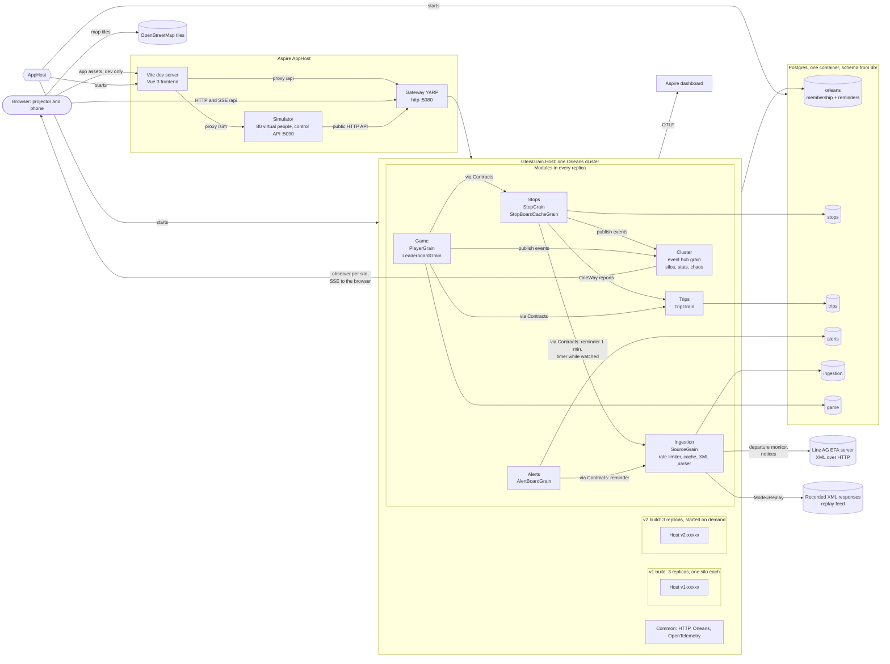

# Architecture

Mermaid source. In Excalidraw use "Insert > Mermaid to Excalidraw" and paste the diagram block.
Everything in the diagram is built. For how to work on the code see [CONTRIBUTING.md](CONTRIBUTING.md), for the HTTP API Scalar on the running host (http://localhost:5080/scalar) and the `.http` files in `src/Host/http`, for agents [AGENTS.md](AGENTS.md).

Modules call each other through the `Contracts` projects only. The Cluster module is the hub for live updates: modules publish events to one grain, every silo has one observer on it (subscriptions expire unless renewed), and each replica forwards the events to its browsers as server-sent events, so an event raised on any silo reaches a browser on any replica. Three replicas of the host form one Orleans cluster of identical silos, each with its own silo and gateway port from Aspire. The gateway keeps one stable address in front of them. The chaos button kills the replica that receives the request.

Grain versioning demo: the same host is built twice. v1 (`[Version(1)]` on `IStopGrain`) starts with the AppHost; v2 (built with `-p:GrainVersion=2` into `artifacts/v2`) is started by hand in the Aspire dashboard and joins the same cluster. Silo names are `v<version>-<random>`, so the frontend shows the version as colour and the silo as shape. The cluster uses the BackwardCompatible strategy and the LatestVersion selector. The replicas never build at start, they only run what the AppHost built.

The simulator is a separate small app that acts like virtual people through the public API (join, pick a stop, move, read boards). It has a control API to pin N people to one stop, which creates the hot grain on demand.

The Postgres container loads the Orleans schema from `db/` when it starts on an empty volume. The `orleans` database holds membership and reminders, every module has its own database for its grain state.

Splitting a module into its own deployable later needs only a small host that calls its `Add...Module` and `Map...Endpoints`.
