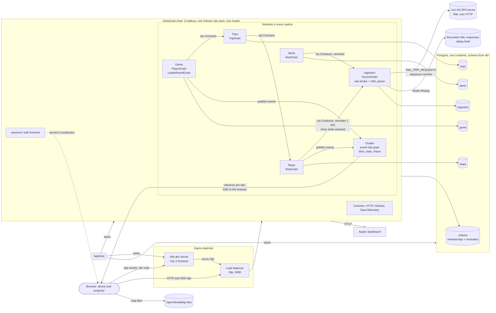

# Architecture

Mermaid source. In Excalidraw use "Insert > Mermaid to Excalidraw" and paste the diagram block.
Solid arrows are built, dashed arrows are not.

Modules call each other through the `Contracts` projects only. The Cluster module is the hub for live updates: modules publish events to one grain, every silo has one observer on it (subscriptions expire unless renewed), and each replica forwards the events to its browsers as server-sent events, so an event raised on any silo reaches a browser on any replica. Three replicas of the host form one Orleans cluster of identical silos, each with its own silo and gateway port from Aspire. The chaos button kills the replica that receives the request.

The Postgres container loads the Orleans schema from `db/` when it starts on an empty volume. The `orleans` database holds membership and reminders, every module has its own database for its grain state.

Splitting a module into its own deployable later needs only a small host that calls its `Add...Module` and `Map...Endpoints`.
