# Talk diagrams: concurrency (part 1) and the rest of the talk (part 2)

> Note: not committed. Paste each Mermaid block into Excalidraw via Insert > Mermaid to Excalidraw.
> Only flowcharts and sequence diagrams are used, no styling, so they convert cleanly. Colour them by hand on the dark slide. All blocks were rendered with mermaid-cli to check the syntax.

Baseline fact for all diagrams: a grain activation processes ONE request at a time (turn-based, single-threaded). Awaiting a call to another grain does NOT release the grain, unless the grain is `[Reentrant]` or the method is `[AlwaysInterleave]` (or `[ReadOnly]` against other read-only calls).

---

## 1. Turn-based execution

**Say:** "Three callers hit one grain: Orleans queues the requests and runs them one after another, so we never need locks, but a slow request makes everyone behind it wait."

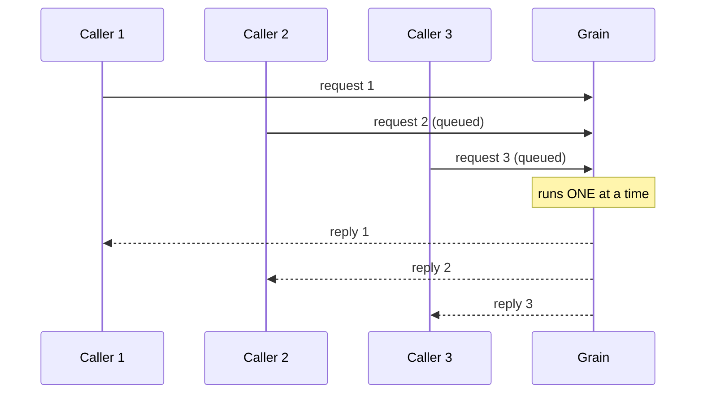

**Excalidraw tip:** make the Grain box thick and bright, colour request 1 green (running) and requests 2 and 3 orange (waiting).

---

## 2a. The deadlock trap (A -> B -> A)

**Say:** "A awaits B, B calls back into A, but A is still busy waiting: nobody can proceed until the call times out (default response timeout 30 s)."

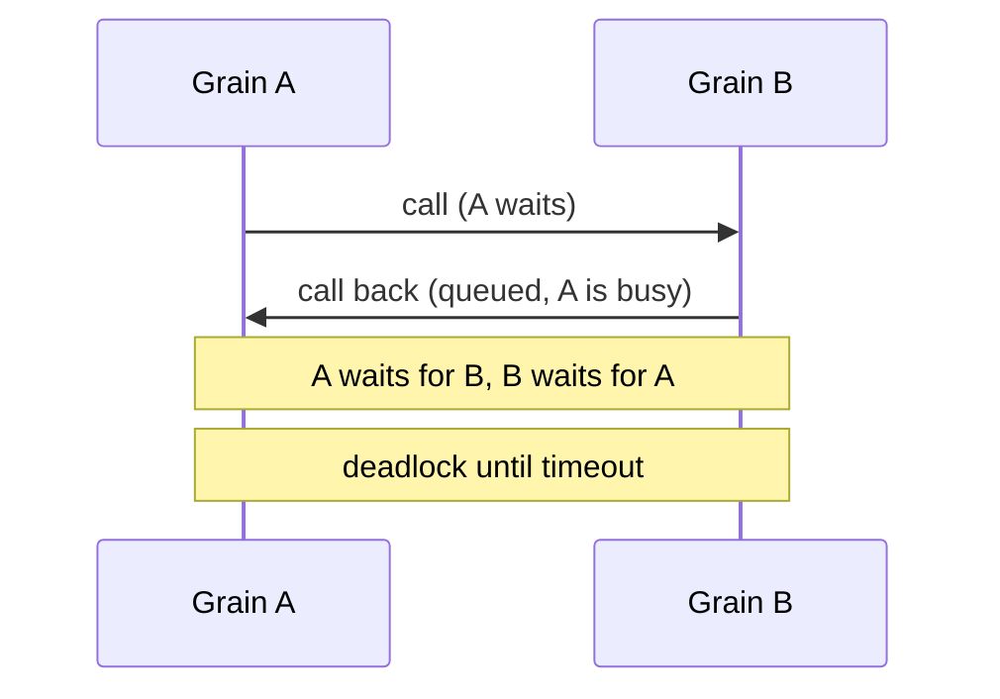

**Excalidraw tip:** draw the two arrows in red, and add a red "X / timeout" label between the lifelines.

## 2b. The fixes

**Say:** "Fix it by allowing interleaving (`[Reentrant]` on the class, `[AlwaysInterleave]` on one interface method) or, better, by removing the cycle: no call back, or a `[OneWay]` call. In this repo Stops reports to Trips with `[OneWay]`, so there is no cycle."

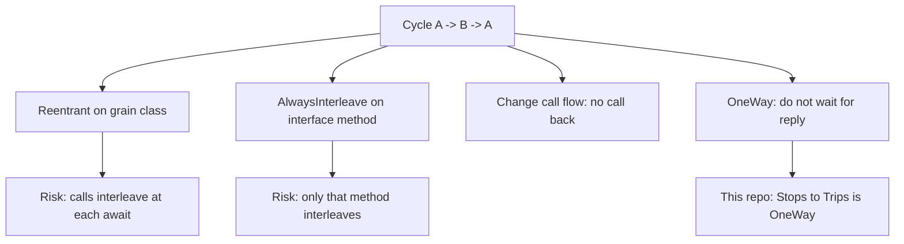

**Excalidraw tip:** problem box red, fixes 3 and 4 green (preferred, no cycle), fixes 1 and 2 yellow (work, but you must reason about interleaving).

Extra (optional spoken note): Orleans also has opt-in call-chain reentrancy (`[AllowCallChainReentrancy]` / `RequestContext.AllowCallChainReentrancy()`), which lets only the same call chain re-enter the grain.

---

## 2c. Fix 1: `[Reentrant]` (slide "Fix 1: reentrancy")

**Say:** "With `[Reentrant]` the grain takes the call back while it waits. Still one thread, but calls interleave at every await."

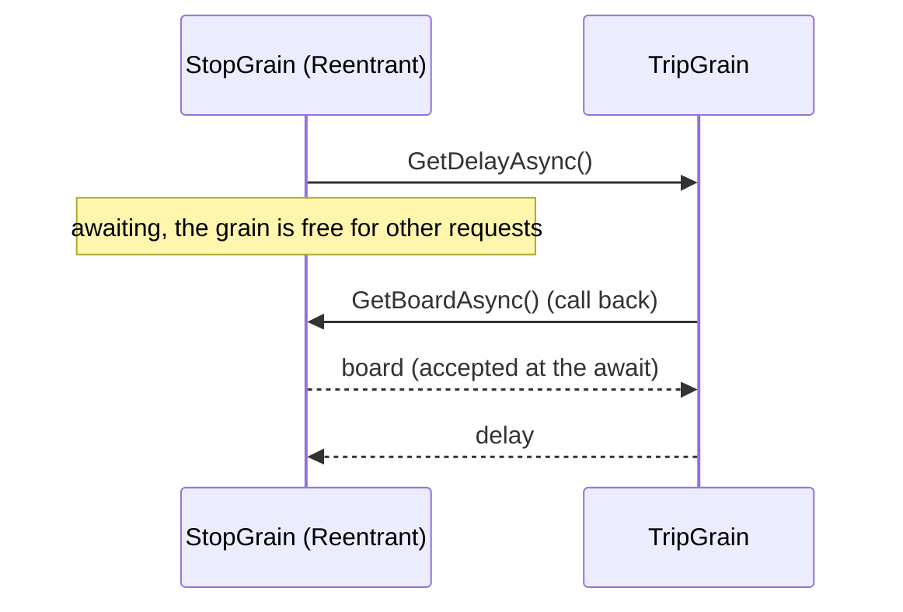

**Excalidraw tip:** the "accepted at the await" arrow in green, a small yellow note "state can change between awaits".

## 2d. Fix 2: `[AlwaysInterleave]` on one method (slide "Fix 2: interleave one method")

**Say:** "Smaller hammer: only the marked method may run while another request waits. Everything else stays turn-based."

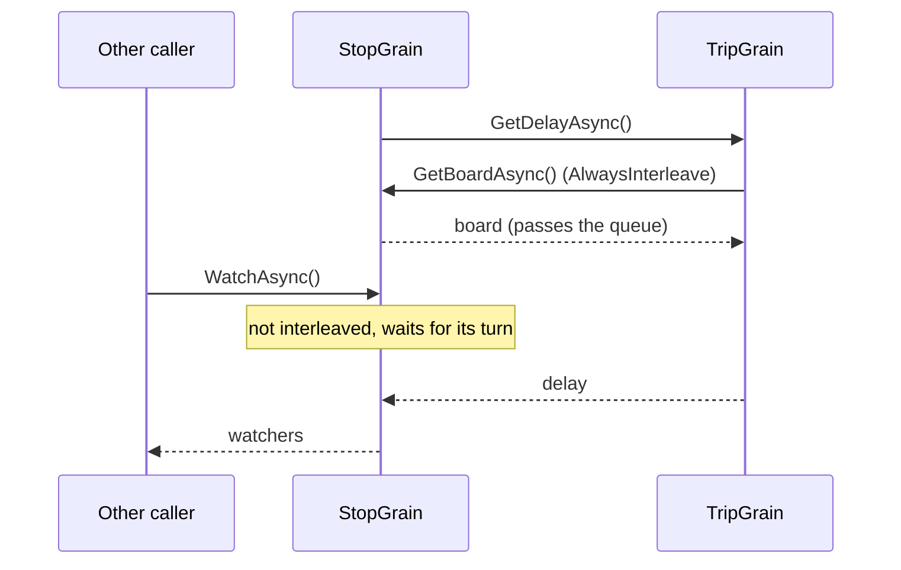

**Excalidraw tip:** green arrow for the interleaved call, grey dashed for the call that has to wait.

## 2e. Fix 3: change the call flow, `[OneWay]` (slide "Fix 3: change the call flow")

**Say:** "Best fix: no cycle. Stop reports to Trip one-way and does not wait. This is what gleis-grain does."

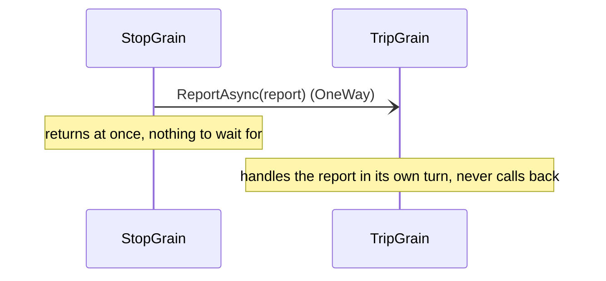

**Excalidraw tip:** one green arrow with an open head, no reply arrow at all; big label "no wait, no cycle".

## 2f. Which fix when?

**Say:** "Prefer a design without a cycle. Interleave only when you have to, and then as narrow as possible."

| Fix | Scope | Risk | Use when |
|---|---|---|---|
| `[OneWay]` / no call back | the call | a lost message is lost | reports and events, answer not needed |
| `[AlwaysInterleave]` | one method | that method runs in the middle of others | a read that is safe at any time |
| `[Reentrant]` | the whole grain | state can change at every await | last resort, simple grain |

**Excalidraw tip:** a three-row table; green for the first row (preferred), yellow, orange for the last.

---

## 3. `[ReadOnly]` methods

**Say:** "Methods marked `[ReadOnly]` may interleave with each other, so many reads run together, but a normal (write) method still waits for them and they wait for it."

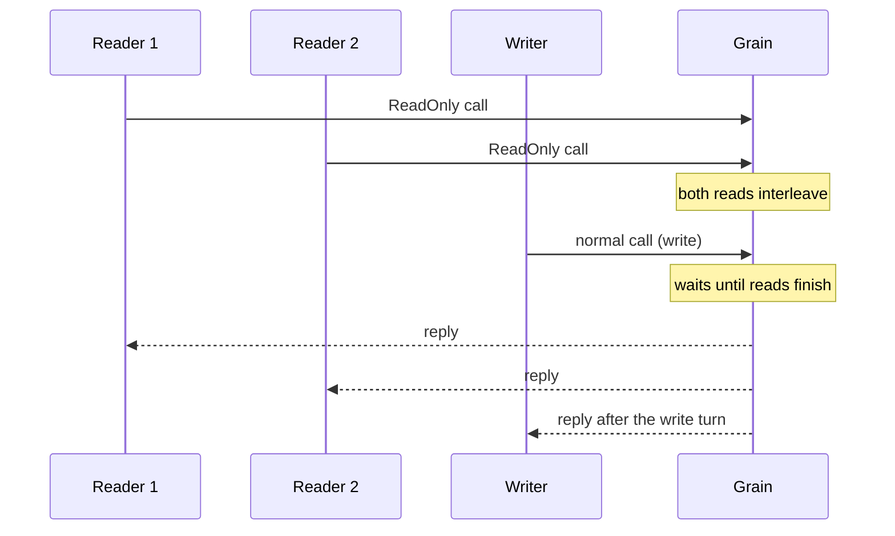

**Excalidraw tip:** reads in blue with the two arrows side by side (parallel), the write arrow in orange to show it waits.

---

## 4. `[StatelessWorker]`: before and after

**Say:** "A `[StatelessWorker]` is not one single activation: Orleans creates several local copies per silo (up to the CPU core count by default) and calls are served by the local silo, which fits caches and read-heavy lookups. Here `StopBoardCacheGrain` (key = stop id, caches the board for a few seconds) sits in front of `StopGrain` when `Stops:UseBoardCache=true`."

Before:

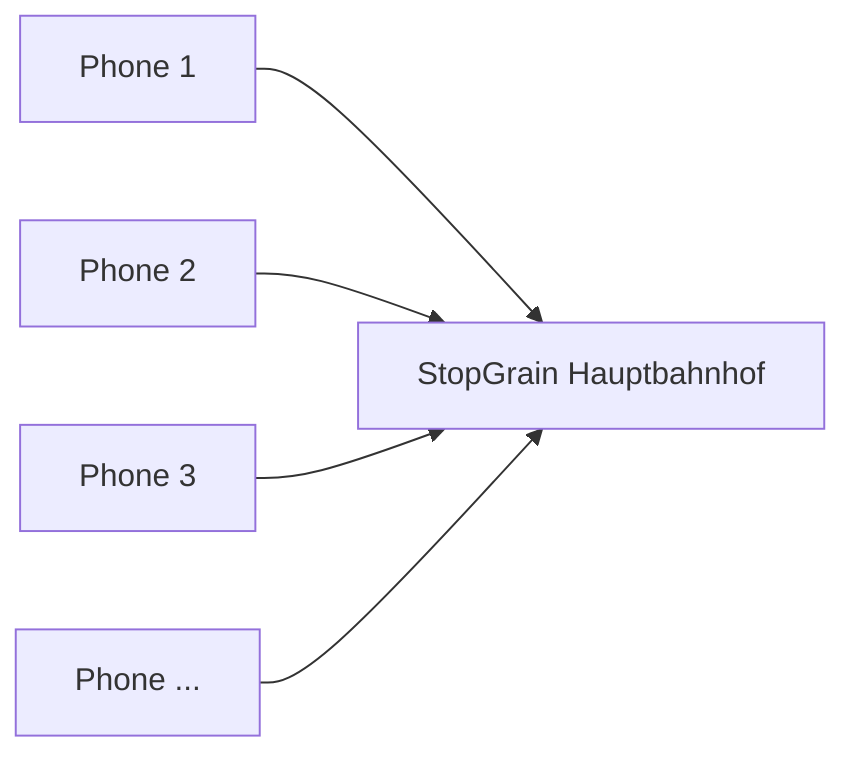

After:

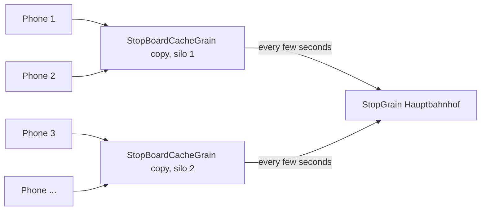

**Excalidraw tip:** before: one fat red StopGrain with many arrows into it; after: cache copies in green (one per silo box), and a single thin arrow to the StopGrain.

Note: stateless workers hold no durable state and the copies may differ slightly, which is fine for a board cached for a few seconds.

---

## 5. Hot grain: Hauptbahnhof

**Say:** "About 100 phones pick the same stop, so one StopGrain on one silo takes every call while other silos idle. First ask: is the key a bad architectural decision, or can we batch and cache?"

Picture of the problem:

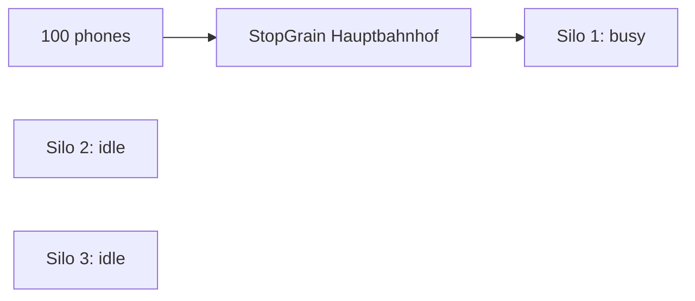

Decision tree:

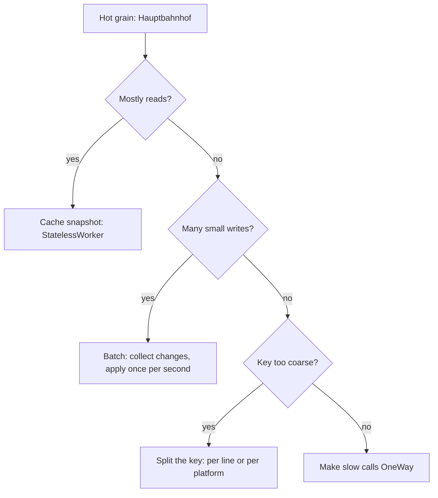

**Excalidraw tip:** the root and the "bad architecture" branch (split the key) in red, cheap fixes (cache, batch, OneWay) in green; make the idle silos grey.

---

## 6. SourceGrain: a deliberate global bottleneck

**Say:** "Here one grain is right: a single SourceGrain is the one rate limiter for the whole cluster (minimum 500 ms between calls to the Linz AG EFA server, results cached per stop for 20 s), which keeps us polite to the server. The price: grain chains block each other, so one slow server call delays every caller; the cache and the stale fallback soften this."

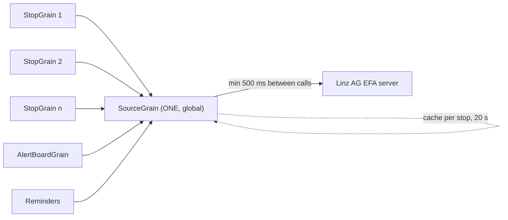

**Excalidraw tip:** SourceGrain big and red/orange with a "queue" label, EFA server grey; add a small green note "cache + stale fallback" next to the self-arrow.

---

## 7. Cheat sheet

**Say:** "Grain slow? Follow the arrows: read-heavy, cycle, too hot a key, or must be global."

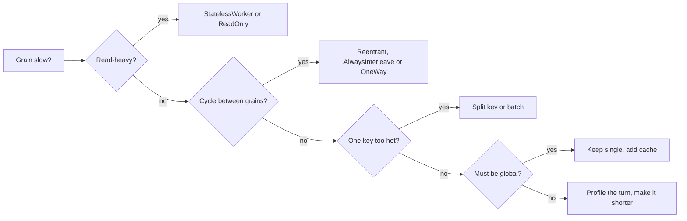

**Excalidraw tip:** question diamonds in one row (left to right), answers in green boxes above and below, and keep the arrow labels (yes/no) bright.

---

# Part 2: diagrams for the other sections of the talk

Facts below follow the repo (gleis-grain): Postgres for membership, reminders and grain state (one database per module), three host replicas = three silos, a gateway in front, the Linz AG EFA server behind one `SourceGrain`.

## 8. Grain lifecycle and persistence (slides "A grain with persistent state", "Grain persistence")

**Say:** "A grain is activated on the first call, reads its state, handles requests, writes state when it asks to, and is deactivated when idle. The state survives in Postgres."

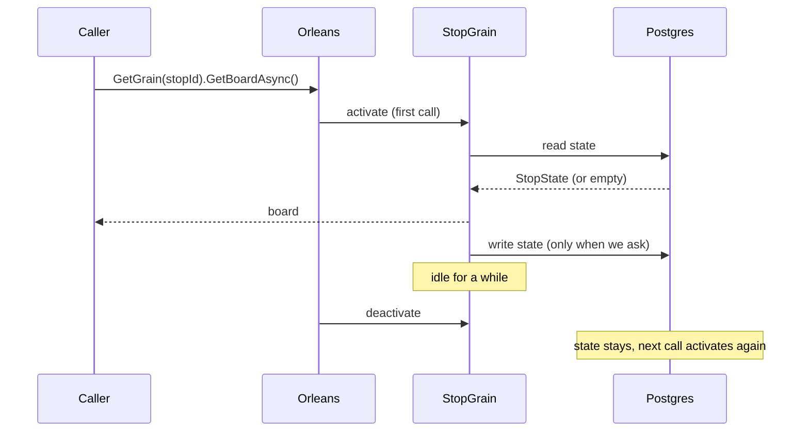

**Excalidraw tip:** draw the grain box only between "activate" and "deactivate"; make Postgres a cylinder; write-behind (not every refresh) in yellow.

## 9. Timers versus reminders (slide "Timers vs reminders")

**Say:** "A timer lives in memory and dies with the activation. A reminder is stored in the database and fires again, even on another silo, after a crash."

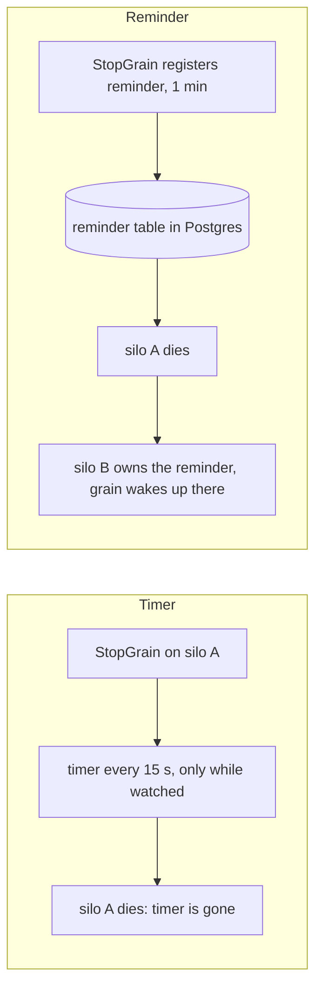

**Excalidraw tip:** timer side in orange (fine to lose), reminder side in green (durable); put the Postgres cylinder in the middle of the reminder side.

## 10. Membership and a dying silo (slide "Cluster: membership", chaos demo)

**Say:** "Silos watch each other. When one stops answering, the others vote it dead in the membership table. Its grains are activated on the surviving silos with the next call."

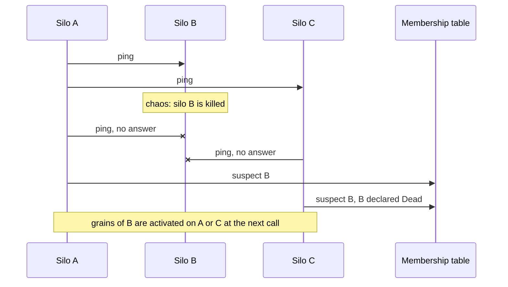

**Excalidraw tip:** silo B in red after the kill; the membership table as a cylinder; show the "Dead" row in red. Demo query: `SELECT * FROM orleansmembershiptable;`.

## 11. Directory and placement (slide "Cluster: directory and placement")

**Say:** "Every call needs to find the grain: the directory says where an activation lives; if there is none, placement chooses a silo."

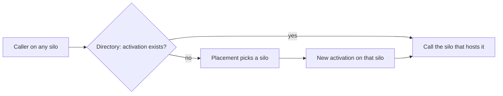

**Excalidraw tip:** the two diamond branches in different colours; add a small note "default placement since Orleans 9.2: resource optimized (before: random)", as in the talk notes.

## 12. Live updates: observers and server-sent events (slide "Live updates")

**Say:** "A grain publishes an event to one hub grain. Every silo subscribed one observer, so every replica gets it and pushes it to its browsers over SSE."

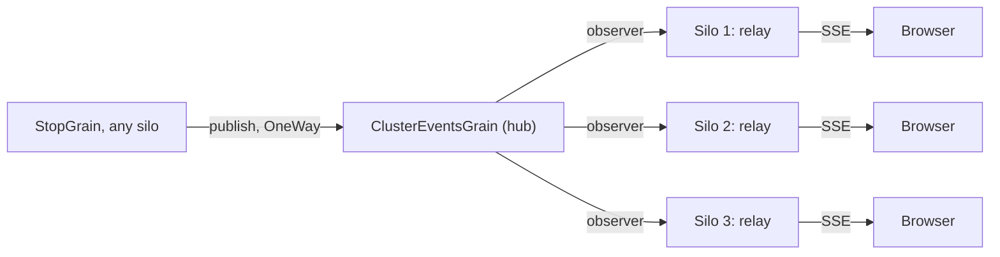

**Excalidraw tip:** the hub in the middle in purple; subscriptions expire, so draw a small clock on the observer arrows ("renewed every 20 s, a dead silo drops out").

## 13. Rolling update: v1 to v2 (slides "Versioning: rolling updates", "Demo: rolling update")

**Say:** "v2 silos join the same cluster. New activations go to v2, v1 callers still work. Then v1 is stopped and everything runs on v2."

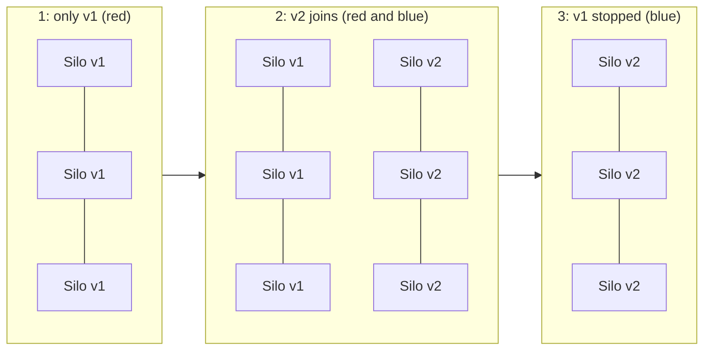

**Excalidraw tip:** v1 boxes red, v2 boxes blue (as on the map); shape per silo slot (square, circle, triangle) so it matches the projector page. Under step 2 add "BackwardCompatible + LatestVersion".

## 14. Architecture: the demo as a whole (slide "Modular monolith, 3 replicas")

**Say:** "One host, six modules, three replicas that form one Orleans cluster. Postgres holds membership, reminders and state. Linz AG is asked by one grain only."

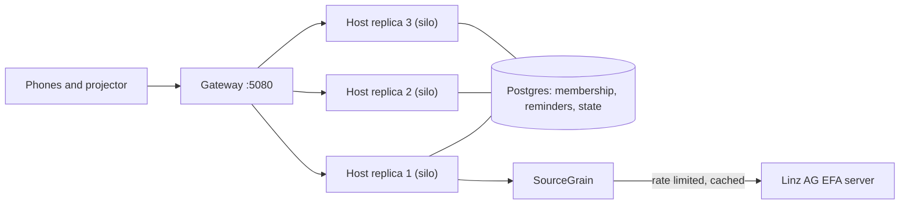

**Excalidraw tip:** group the three replicas in one dashed box labelled "one Orleans cluster"; Postgres as a cylinder; Linz AG outside the box. This is also the diagram for the "Demo: break the cluster" slide.

