# How Orleans works, in plain words

Slides as markdown. Each `---` is a new slide. The diagrams are Mermaid, GitHub and the VS Code preview with the Mermaid extension render them.
Facts about failure detection and placement are from the Orleans docs (cluster management, grain placement).

---

## The idea in one picture

A **grain** is a small object with an identity (`StopId`) and its own state.
Orleans keeps it in memory when it is used and forgets it when it is idle. You never create or destroy it, you just call it.

Think of an office:

| Orleans | Office |
|---|---|
| Grain | A clerk responsible for exactly one stop |
| Silo | An office building, a .NET process |
| Cluster | All buildings of the company |
| Grain reference | The clerk's phone number (always valid, even if the clerk is at home) |
| Activation | The clerk is at the desk right now |

---

## What does "virtual" mean?

Like virtual memory: the address is always valid, real memory is put behind it only when you touch it.

- A grain **always exists logically**. `GetGrain<IStopGrain>("vienna-hbf")` works for any id, nobody keeps a list of valid grains.
- Only an **activation** (the in-memory instance on one silo) comes and goes. It is created on the first call and removed when idle or when its silo dies.
- Classic actors (Akka, Erlang): you spawn, keep the reference and handle death yourself. Orleans: identity is permanent, only the instance is temporary.
- Side effects:
  - A typo (`linz-hbff`) silently gets its own empty grain. Validate ids against a known list at the edge.
  - "Does it exist?" is an application question (is there stored state?), not an Orleans one.
- Not the scheduler that creates it. The runtime does on the first message: placement picks the silo, the silo registers the grain in the directory, creates the activation and loads the state. The scheduler only runs turns on threads.
---

## The big picture

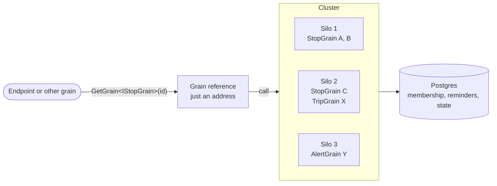

Rule: you never say which silo. Orleans finds or creates the grain for you. This is *location transparency*.

---

## What happens on a call

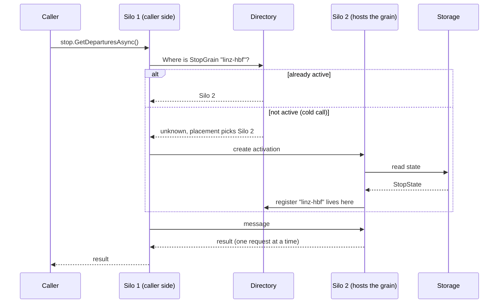

The first call is slower (cold). The next ones go straight to the silo, the answer is cached.

---

## One request at a time

Every grain activation has a mailbox and handles **one message at a time** (a "turn").

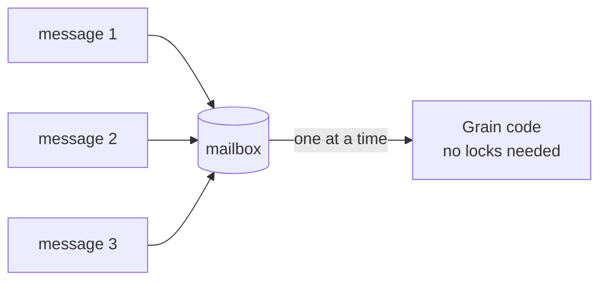

- No locks, no race conditions inside the grain.
- The price: a slow call blocks the following ones. Hence `[ReadOnly]`, `[Reentrant]`, `[StatelessWorker]` for hot grains.
- The deadlock trap: A waits for B while B waits for A. Both mailboxes are busy, nobody moves. It ends in a timeout.

Interleaving options and the deadlock trap are on the next slide.

Words: this queue is the **mailbox** (the Orleans docs say request queue / turn-based execution). It lives in memory on the silo, queued messages are lost if the silo dies and the callers get a timeout.

---

## Reentrancy: deadlocks and interleaving

Default is safe: one request runs from start to finish before the next one starts, even while it waits on an `await`. Two prices:
- **Deadlock:** A waits for B while B waits for A. Both mailboxes are busy with a call that cannot finish, it ends in a timeout.
- **Throughput:** while a grain awaits a database or an HTTP call, nothing else runs.

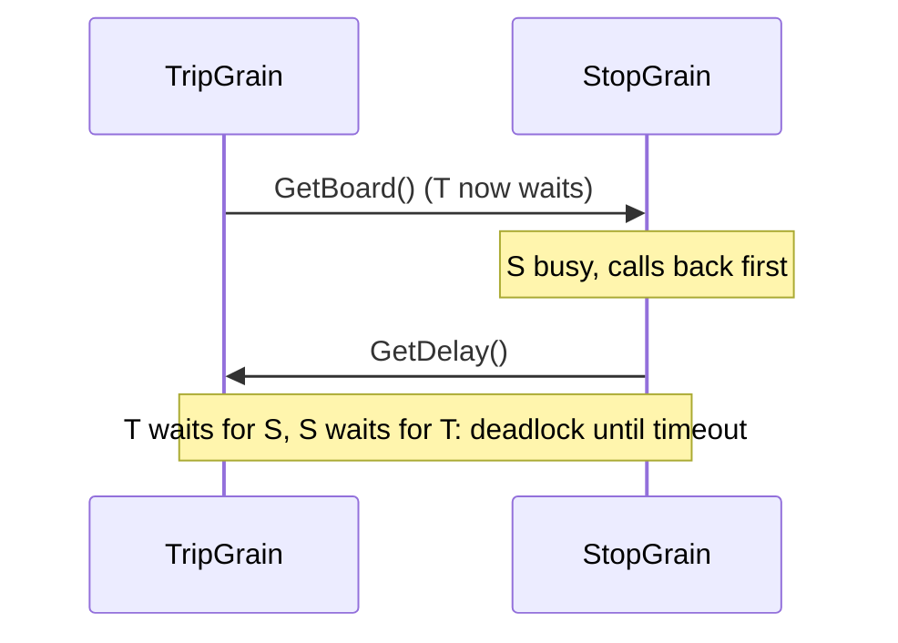

Options (all from the Orleans docs):

| Option | Where | Effect |
|---|---|---|
| `[ReadOnly]` | interface method | Does not change state, may run concurrently with other `[ReadOnly]` methods |
| `[AlwaysInterleave]` | interface method | Always interleaves with any request, and any request may interleave with it |
| `[Reentrant]` | grain class | All methods may interleave with each other |
| `[MayInterleave(predicate)]` | grain class | A static method decides per call, for example from the argument type |
| `RequestContext.AllowCallChainReentrancy()` | call site | Lets calls further down this call chain come back into the grain. Dispose the scope when done. `SuppressCallChainReentrancy()` stops it from flowing on |

How to manage it:
1. **Stay non-reentrant by default.** Safe, and one request at a time is exactly what removes locks.
2. **Break cycles first.** Redesign so grains do not call each other in a circle: pass the data in the call, or let one side only be called and never call back.
3. **`[ReadOnly]` for queries** that really change nothing (`GetBoard`).
4. **`[AlwaysInterleave]` for small independent methods** such as a status call that must answer while a slow call runs.
5. **`AllowCallChainReentrancy()` for a known cycle**, scoped to that one call instead of the whole class.
6. **`[Reentrant]` only** for grains that hold almost no state and mostly await (HTTP, database), and only after checking every `await`.

The trap with interleaving: state you read before an `await` may have changed when you resume. The docs example is a counter: read, `await`, write back, and concurrent calls lose increments. Do the read-modify-write without an `await` in between, or re-read after it. The docs warn that this is an advanced feature, so incorrect use gives races and corrupted state that are hard to diagnose.

**Reentrancy options only change how requests are scheduled inside that one activation.** `[Reentrant]`, `[ReadOnly]` and the others never create a second activation, they only let calls overlap inside the same one (still one thread, calls take turns at each `await`). The ETag does not help here: it is the same activation, so there is no storage conflict, only your in-memory state to protect.

In gleis-grain:
- Trip <-> Stop is the deadlock demo: [TBD]
- While `StopGrain` waits for the EFA answer it blocks. Better: the fetch lives in Ingestion, and `GetBoard` on the stop is `[ReadOnly]` and answers from state: [TBD]
- The rate limiter in Ingestion stays non-reentrant on purpose, it must count requests in order.

---

## Reentrancy options, one by one

**The reentrancy options only change how requests are scheduled inside that one activation.** One identity still has one activation, one copy of the state in memory, one thread. The only thing that creates several activations of one id is `[StatelessWorker]`.

**`[ReadOnly]`** (interface method)
- Promises not to change state. Several `[ReadOnly]` calls may run together, not together with normal calls.
- For queries such as `GetBoard()`.

**`[AlwaysInterleave]`** (interface method)
- May run at any time, even while a slow call waits, and others may run during it.
- For small independent methods, for example a status call that must answer during a long call. Broader than `[ReadOnly]`.
- Docs example: three calls that wait 10 s each finish in about 10 s instead of 30.

**`[Reentrant]`** (grain class)
- Every method may interleave with every other method.
- The broad switch. Only for grains with almost no state that mostly wait on HTTP or a database.

**`[MayInterleave(predicate)]`** (grain class)
- A static method you write decides per call whether it may interleave, for example from the argument.
- When only certain requests should overlap.

**`AllowCallChainReentrancy()`** (call site)
- Wraps one call: while the scope is open, calls further down that chain may come back into your grain.
- Fixes a known cycle without opening the whole class. Dispose the scope when done.

**`SuppressCallChainReentrancy()`** (call site)
- The opposite: stops that permission from being passed further down the chain.

```csharp
// one known cycle, only for this call
using var scope = RequestContext.AllowCallChainReentrancy();
await roomGrain.OnJoinRoom(this.AsReference<IUserGrain>());
```

From safest to riskiest (own judgement, not from the docs): `[ReadOnly]`, `AllowCallChainReentrancy()`, `[AlwaysInterleave]`, `[MayInterleave]`, `[Reentrant]`.

---

## `[Reentrant]` vs `[AlwaysInterleave]`

Both let calls overlap inside one activation. The difference is how many methods they affect.

| | `[Reentrant]` | `[AlwaysInterleave]` |
|---|---|---|
| Put on | The grain class | One interface method |
| Which calls may overlap | Every method with every other method, also a method with itself | Only the marked method, but with any other request |
| Other methods | All overlap with each other | Still one at a time among themselves |

Example, a grain with `Slow()` (normal) and `Fast()` (`[AlwaysInterleave]`):

| Two calls | Overlap? |
|---|---|
| `Slow` + `Slow` | no, one after the other |
| `Fast` + `Fast` | yes |
| `Fast` + `Slow` | yes, in either order |

If the class were `[Reentrant]`, `Slow` + `Slow` would overlap too.

- `[Reentrant]` is the broad switch: the whole grain interleaves, so every method must be safe against overlap.
- `[AlwaysInterleave]` is a targeted exception: only the marked method breaks the one-at-a-time rule, the rest keeps the safe default.
- Pick `[AlwaysInterleave]` for something like a status call that must answer during a long call. Pick `[Reentrant]` only for a grain with little state that mostly waits.

---

## Who knows where a grain lives? The directory

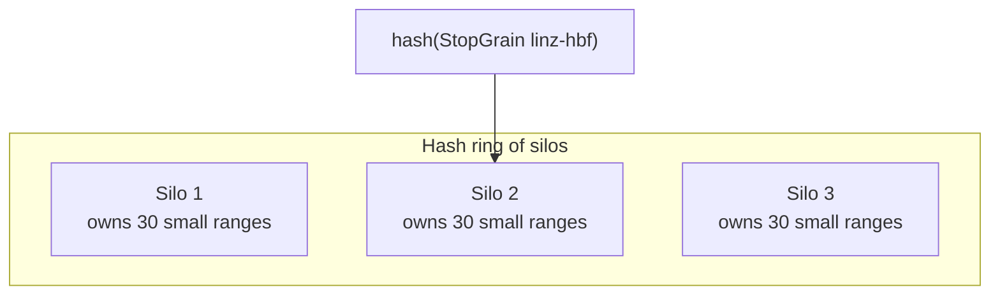

- The directory is split over all silos: the id is hashed and the silo that owns that range knows where the grain is.
- Silos cache answers, so most calls skip the lookup.
- Normally there is **one** activation per grain. During a failure a short overlap can happen, Orleans cleans it up.

When is it filled?
- On activation: placement picks a silo, that silo **registers** the id in the directory first (if another silo was faster, the call is forwarded there), then it creates the activation.
- On deactivation the entry is removed. When a silo is declared dead its entries become invalid, the next call registers the grain again.
- It is in memory only, not in Postgres. After a full restart it starts empty and fills again as calls arrive. Silos cache answers, stale ones are corrected by forwarding.

---

## The directory in detail

**It is distributed.** No directory server, no table in Postgres. Every silo holds a piece in memory: the entries for the grain ids whose hash falls into its ranges.

**Ranges, not slices** (from the docs)
- The hash of a grain id is a point on a ring. The ring is cut into ranges, each owned by one silo.
- Each silo owns **30 small ranges** by default, scattered over the ring (like virtual nodes in Cassandra or Dynamo).
- A range runs from its own hash position to the next one, so sizes vary. Added up, every silo gets about the same share (3 silos: about a third each).
- Not fixed: a joining silo makes existing ranges shrink, a leaving or dead silo's ranges are taken over by its neighbours. Only those parts move.
- During such a change the old owner seals the range and hands a snapshot to the new owner, that keeps the directory strongly consistent (default since Orleans 9.0).

**Consistent hashing, but with an extra step**
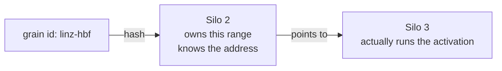
- Classic consistent hashing (Cassandra): the hash decides **where the data lives**.
- Orleans: the hash decides **who knows** where the grain is. Placement decides separately where it runs, so the activation can sit next to its caller or on the least loaded silo.
- Consistent hashing appears three times: directory ownership, failure detection (probing the next silos on a ring of silo identities) and the optional hash-based placement, which does put the activation on the hashed silo.

**What an entry contains** (field names from memory)
```
GrainId       StopGrain / "linz-hbf"
SiloAddress   10.0.1.5:11111:1698765432     ip:port:epoch
ActivationId  unique id of this activation
```
- The epoch is the silo's start time. A restarted pod has the same `ip:port` but a new epoch, so it counts as a different silo. Entries and cached addresses pointing to the old epoch are known to be dead.
- The same `ip:port:epoch` identity is used in the membership table, in the directory and in messages.

---

## Where does a new grain go? Placement

When a grain is not active, Orleans picks a silo. This is also how the load is spread.

- Default since Orleans 9.2: **resource-optimized** (looks at CPU and memory). Before: random.
- `[PreferLocalPlacement]`: on the silo of the caller.
- Hash-based, activation-count-based, or your own strategy.

Placement only runs for the *first* call. Afterwards the grain stays where it is until it is deactivated.

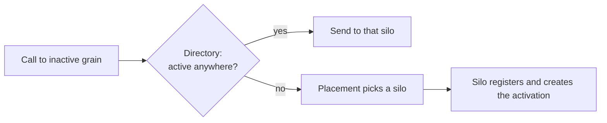

Only silos that can host the grain type are candidates. In gleis-grain a `StopGrain` can only land on a Stops silo.

---

## A grain's life

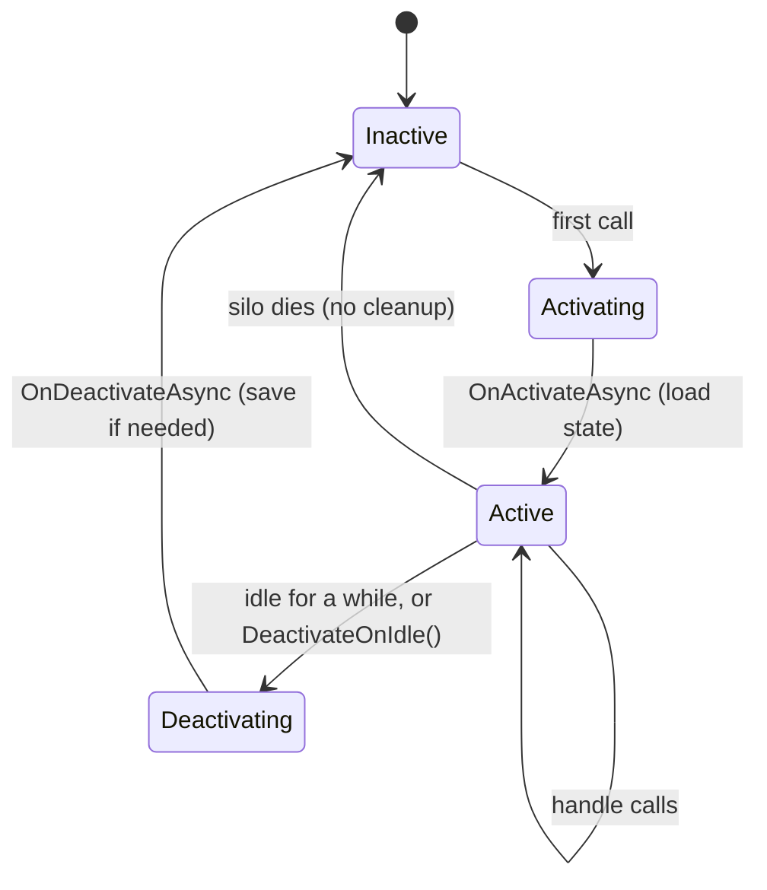

- Nothing is created or deleted by you. Idle grains are collected automatically.
- State is **not** saved by magic: you call `WriteStateAsync()` yourself. If two writers collide, the stored version number (ETag) makes the second one fail instead of overwriting.
- A grain that was never written has no record. The next activation starts with empty state.

---

## What is an ETag?

An **ETag** (entity tag) is a version marker that the storage attaches to a stored record. It changes on every write. You never interpret it, you only hand it back.

It is the same idea as HTTP `ETag` and `If-Match`: "only change this if it is still the version I read".
This is **optimistic concurrency**: nobody locks anything, a conflict is detected when it happens.

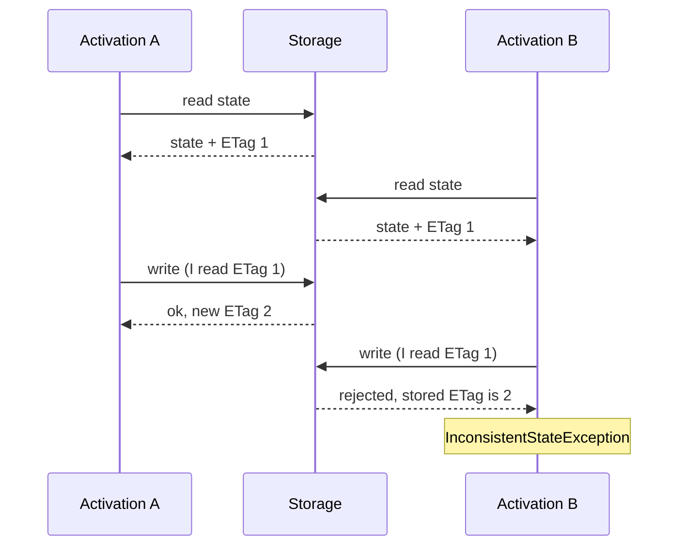

In Orleans:
- `IPersistentState<T>` keeps the ETag next to your state. `ReadStateAsync()` loads both, `WriteStateAsync()` sends the ETag along.
- If the stored ETag differs, the write throws `InconsistentStateException`. Nothing is overwritten.
- Normally there is one activation, so this is rare. It shows up when two activations of one grain exist: a short overlap during a failure, or two clusters sharing the same storage (blue/green, canary).
- What to do: the in-memory state is stale. Do not retry blindly with the same data. Let the grain reload (usually by deactivating it, the next call loads fresh state) and then decide whether the operation should be repeated.
- It protects stored state, not the grain's in-memory work: the loser may already have sent messages or fired side effects. Keep side effects idempotent.

---

## Timers and reminders

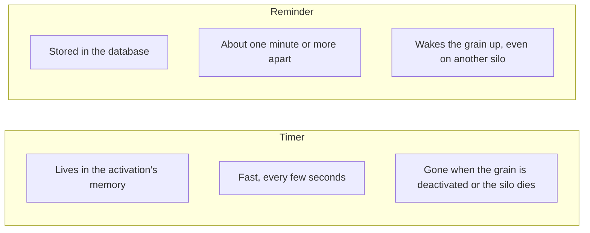

Easy rule: **timer = sticky note in your pocket, reminder = entry in a shared calendar.**
If the pocket is lost, the note is gone. The calendar entry still fires.

---

## Reminders: how they work and what happens when silos change

Facts marked (docs) are from the Orleans docs, the rest is from knowledge of the implementation, check before quoting.

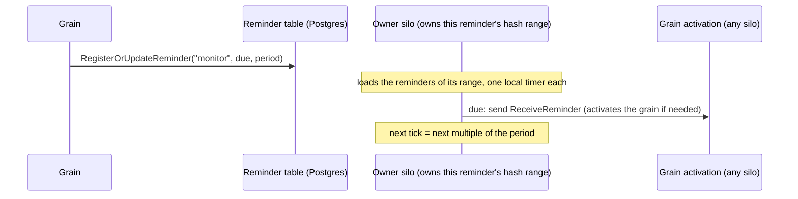

- **Storage:** one row per reminder (service id, grain id, name, start time, period) in the `orleans` database. It survives deactivation, crashes and deployments.
- **Ownership (docs):** the reminder service is distributed. It is implemented as a **grain service**: a service with one instance per silo, each responsible for a subset of grains. Which silo serves which reminder is decided by consistent hashing, a scheme similar to the grain directory's. The docs describe the two separately, so do not say they share one ring.
- **Firing:** the owner silo has a local timer per reminder and sends the grain a message. The grain must implement `IRemindable.ReceiveReminder`.
- **No record of fired ticks.** Ticks are anchored to `start time + n x period`. A restarted or new owner computes the next tick from the clock, it does not replay missed ones.

**Rebalancing when the cluster changes**

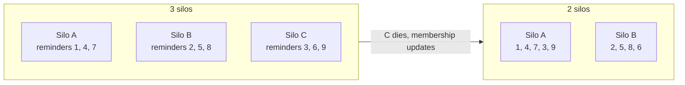

1. Membership declares C dead (about 15 s by default) and the ranges C owned go to its neighbours on the ring.
2. A and B load the reminders of their new ranges from the table and start local timers. Nothing is moved between silos, the table is the source.
3. Ticks due in the gap are late or skipped. The next tick follows the schedule.
4. A silo that **joins** takes over some ranges, the old owners stop their timers for them.
5. Around the handover a tick can come twice or late. Make the handler idempotent.

**Design rules**
- A reminder means "wake me up about every N minutes", never "this event will arrive".
- Keep progress in the grain's state. The reminder only says "continue from where the state says you are".
- Never count ticks.

---

## How the cluster knows who is alive (membership)

Every silo is a row in a shared table (here `orleansmembershiptable` in Postgres). The silos watch each other, the table only stores the result.

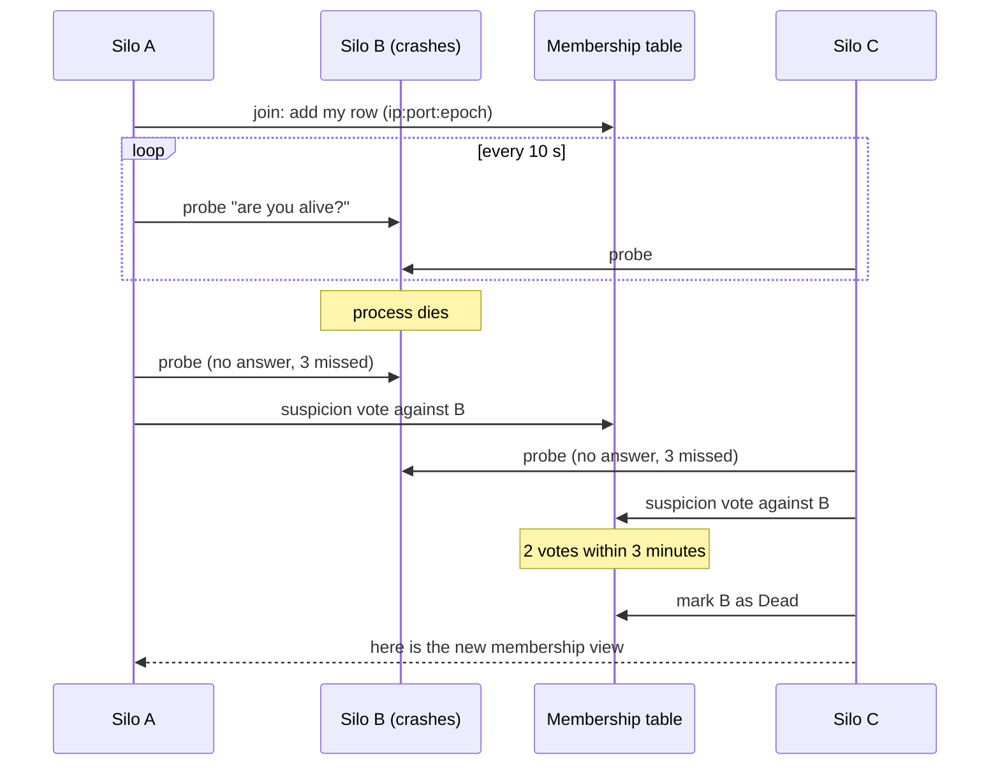

Defaults from the docs: each silo is watched by 10 others, a probe every 10 s, 3 missed probes make a suspicion, 2 suspicions declare a silo dead. Detection takes about 15 seconds. Before declaring, a silo asks a third silo to probe too ("indirect probing"), so one flaky network link does not kill a healthy silo.

The probes go silo to silo, not through the database. The database is just where everybody agrees on the result.

---

## Which silo belongs to which cluster?

Configuration decides, nothing is detected automatically.

| Setting | Meaning |
|---|---|
| `ClusterId` | One running deployment. Silos with the same cluster id and the same membership table form one cluster |
| `ServiceId` | The logical service. Stays the same across deployments, reminders and stored state are tied to it |
| Membership table | Shared storage with one row per silo (`ip:port:epoch`) |

**Rule of thumb: `ServiceId` = which application, `ClusterId` = which running copy of it.** A blue/green deployment keeps the `ServiceId` and changes the `ClusterId`.

**Why two ids and not one?** They have different lifetimes.

| | Question | Changes when a new cluster starts? |
|---|---|---|
| `ServiceId` | Whose data is this (reminders, stored state)? | Never, or the new deployment cannot find the old data |
| `ClusterId` | Which silos belong together and may call each other? | Yes |

With one id:
- **stable:** blue and green would be the same id, so their silos form one cluster. No side-by-side clusters, no way to tell them apart in the membership table.
- **changing per deployment:** the new cluster loses the old one's reminders and state.

Normally you never run two clusters at once, then both are fixed and can even have the same value (as in this repo). Blue/green is the case where they must differ.

Membership = the agreed list of silos that are alive. Three users:
- the **directory** (which silos share the hash ring),
- **placement** (only live silos get new grains),
- **clients** (they read it to find gateways).

All silos of one cluster must use the same `ServiceId`. Different applications (say gleis-grain and a taxi app) get different `ServiceId`s **and** different clusters. They can share one database without clashing, because reminders and some storage providers separate their rows by `ServiceId`. Changing the `ServiceId` of a running service makes its old reminders and data invisible.

In gleis-grain (`OrleansExtensions.cs`): ClusterId and ServiceId are both `gleis-grain`, the table is the `orleans` database. The host is one deployable with all four modules, every replica is one silo, and the replicas form the cluster.
---

## When a silo dies

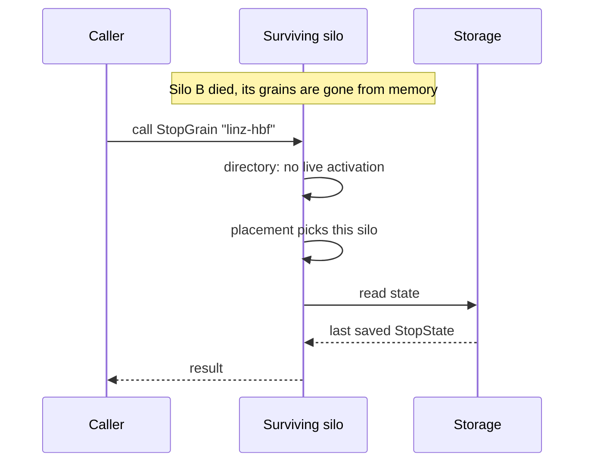

- Nobody has to restart or move grains. The next call just creates the activation somewhere else.
- What survives: saved state and reminders. What is lost: anything only in memory (timers, unsaved changes), so decide what is fine to lose.
- Calls that were running on the dead silo fail (timeout, default 30 s). Orleans does **not** retry for you, the caller decides. Make operations safe to repeat.

---

## Clients, gateways and the API in front

A **client** hosts no grains and is not a cluster member (not probed, owns no directory part). It reaches the cluster through a **gateway silo**:
- every silo can open a gateway endpoint (`GatewayPort` in `OrleansOptions`),
- the client reads the membership table, connects to some gateways and sends calls through them,
- the gateway forwards to the silo that holds the grain, possibly one extra hop.

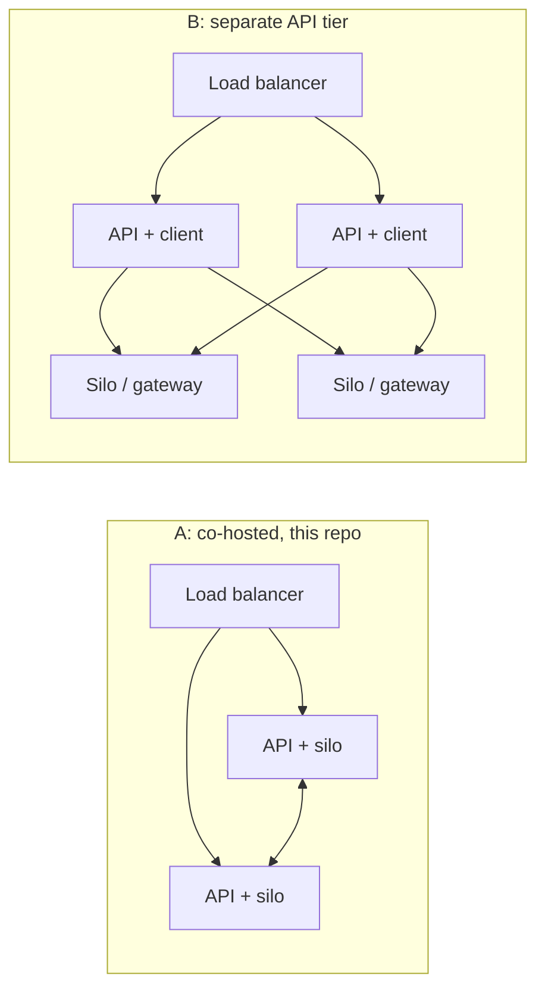

| | A: co-hosted | B: separate API tier |
|---|---|---|
| Hops | Straight to the grain, a hop only if it lives on another silo | Client, gateway, maybe another silo |
| Scaling | API and silos together | Web traffic and grain work apart |
| Isolation | A web spike steals CPU from grains | Silos protected, ports not exposed |

Is the API a bottleneck? Rarely, it is stateless and scales out. The real limits:
- a **hot grain** (one mailbox, one message at a time) -> `[StatelessWorker]` or a cached snapshot,
- **slow calls held open** -> timeouts, long work in a reminder,
- the **database** (membership, reminders, state).

Start co-hosted, split when the scaling or security needs differ.
---

## Heterogeneous or homogeneous silos?

It is the **cluster** that is heterogeneous, not one silo. Each silo hosts a set of grain types.

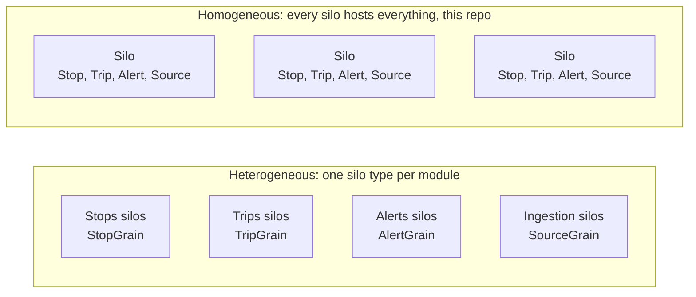

| | Heterogeneous | Homogeneous |
|---|---|---|
| Deploy and scale | Per context, scale Stops without touching Alerts | One image, one thing to scale |
| Isolation | A noisy or crashing context hurts only its own silos | Shared CPU, memory and failures |
| Calls between contexts | Mostly a network hop to another silo | Often in-process, `[PreferLocalPlacement]` helps |
| Placement | A grain type can only use its own silos | The whole cluster |
| Minimum pods | 2 per context for resilience (8 here) | 2 for everything |
| No live silo of a type | Calls to it fail until one is back | Cannot happen |
| Release | Versions can differ, interface versioning across deployments matters | One version everywhere |

Switch to homogeneous when:
- contexts call each other a lot and hops dominate latency,
- each context needs little capacity and many pods sit idle,
- one team releases everything together anyway,
- load is uneven and rebalancing between silo types is not possible.

Stay heterogeneous when:
- scaling differs a lot (strict rate limit in Ingestion, heavy compute for AI agents),
- different teams own and release contexts separately,
- you need strong isolation or security boundaries.

gleis-grain: homogeneous, a modular monolith. One host contains all four modules, replicas are identical silos. It started as four separate hosts (heterogeneous), merged because the load is small. Splitting back later is a small host per module that calls only its own `Add...Module` and `Map...Endpoints`.

---

## Several clusters: how and when

Clusters are independent. Only silos and clients with the **same `ClusterId`** talk directly. A grain of cluster A cannot be called from cluster B, if you need that you build it yourself (an API or messaging between them, one client per cluster).

How it is set up:
- Different `ClusterId` = different cluster. Membership rows are keyed by silo identity plus cluster id, so clusters can even share one membership table.
- Same `ServiceId` in all clusters of one logical service, because stored state and reminders are tied to it.

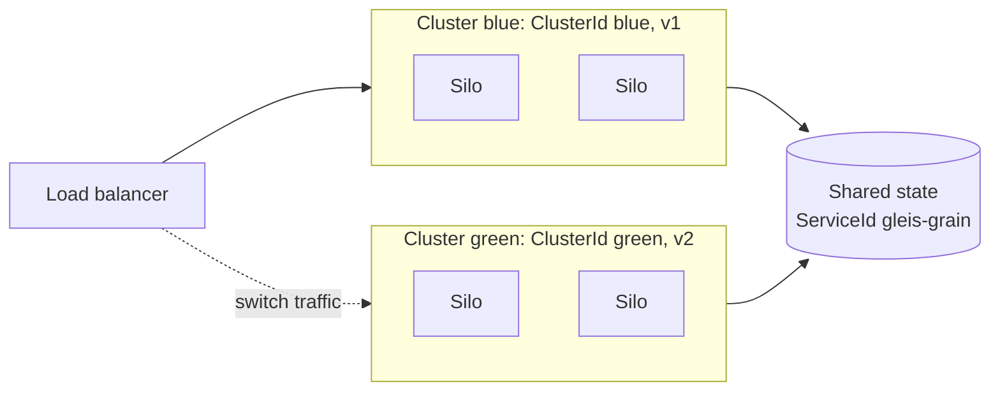

A new cluster with the **same `ServiceId`** and the same storage sees the old data. It starts cold, grains load their saved state when they are first called (like after a full restart).

What carries over and what doesn't:

| Carries over (in the database) | Does not carry over (per cluster) |
|---|---|
| Stored grain state | Activations in memory |
| Reminders (tied to the `ServiceId`) | Timers |
| | Directory entries |
| | Membership (separate cluster, separate rows) |

Two caveats:
- Whether state is found also depends on the same storage connection, grain types and keys. "Same `ServiceId` and same database" is the safe combination.
- While both clusters run, the same grain id can be active in both. The ETag protects the stored state, not the two in-memory copies. Keep the overlap short and the state readable by both versions.

When it makes sense (guidance):

| Reason | Example |
|---|---|
| **Blue/green deployment** (documented use) | Start cluster green with the new version, move traffic, shut blue down. Fixed ids plus a rolling update (Kubernetes) is the more common choice |
| **Isolation** | Blast radius, different SLA, tenants, data residency (EU vs US) |
| **Different needs** | Own scaling or hardware, for example a cluster for the AI agents |
| **Region** | One cluster per region for latency, data kept in sync by the application |
| **Environments** | Dev, test, prod are separate clusters. Best: separate databases and networks, then they never see each other. If they share a database, they need different `ClusterId` **and** `ServiceId` |
| **Domains that never call each other** | Two parts of a company with no grain calls between them. No loss of location transparency, so splitting is cheap |
| **Separate applications** | gleis-grain and a taxi app: own `ServiceId` and `ClusterId`, may share one Postgres server |
| **Tenants** | One cluster per customer for isolation, quotas or data residency |

Rule of thumb: **split along the call graph.** Contexts that never call each other's grains can live in different clusters at no cost. Contexts that do call each other belong in one cluster. In gleis-grain, Stops and Trips call Ingestion, so all four stay together.

When it does not:
- Not just because there are several bounded contexts. One cluster with different silo types works, and calls between contexts keep location transparency.
- Not for size. The membership protocol is meant for very large clusters.
- Every cross-cluster call costs you the transparency and needs an explicit API.

Watch out for blue/green: both clusters share state, so the same grain id can be active in both for a while. Version-tolerant state and ETag conflicts matter.

Gleis-grain: one cluster, `ClusterId` and `ServiceId` both `gleis-grain`. One cluster per context would give independent releases but turn every context-to-context call into an API call.

---

## Blue/green step by step

Same `ServiceId`, different `ClusterId`. Two complete clusters, one database. Blue is live, green has the new version. You **switch all traffic at once** and keep blue as an instant way back. A gradual shift (5%, then more) is a canary, not blue/green.

| | Blue/green | Canary | Rolling update |
|---|---|---|---|
| Traffic | All at once, 0% then 100% | Small share first, then more | No split, pods are replaced one by one |
| Both versions serve users | No, only the one that is live | Yes, on purpose | Yes, during the update |
| Rollback | Instant, flip back to blue | Stop the canary | Roll the deployment back |
| Orleans clusters | 2 (new `ClusterId`) | 1, or 2 | 1 (fixed ids) |
| Extra cost | Double the pods during the overlap | A few pods | Almost none |


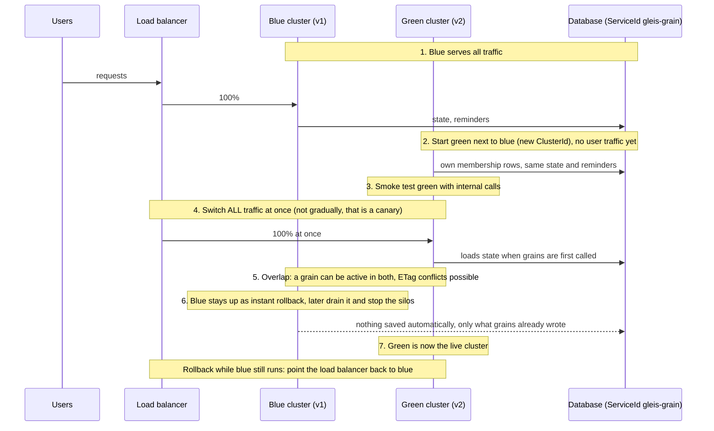

Next release: the roles swap. The new version becomes "blue" again, with a fresh `ClusterId` (for example the version number or a date).

What to take care of (guidance, not from the docs):
- **State must be readable by both versions.** Green writes while blue may still run, and rollback means blue reads what green wrote.
- **Reminders (step 2).** Both clusters share the reminder table, so green may fire reminders although it gets no traffic. Make reminder handlers idempotent, or keep the overlap short.
- **Overlap (steps 5 and 6).** After the switch blue gets no more requests, but it still holds activations and may fire reminders. A grain active in both clusters can hit an `InconsistentStateException` on write. Hot grains conflict the most. Keep the standby window short.
- **Cold start.** Green has no activations, so its first requests are slower while grains load their state. Warm it up in step 3.
- **Lost on drain:** in-memory data, timers, and calls in flight on blue. Let blue go idle and shut it down gracefully.
- **Cost:** double the pods during the overlap.

Rolling update instead: fixed `ClusterId`, new pods join the same cluster and old ones leave, one activation per grain throughout. Prefer it unless you need two fully separate versions, as the Orleans docs describe it as the common case on Kubernetes.

---

## Canary deployments

Where you canary decides whether a second cluster is needed. Usually it is not.

| What you canary | Approach | Clusters |
|---|---|---|
| API only (API and silo are separate) | A few canary API pods get 5% of traffic at the load balancer | 1, the grains are untouched |
| Grain code | Add a few v2 silos to the running cluster, use `[Version]` and compatible state | 1, mixed versions |
| Risky change with its own data | Second cluster with its own `ServiceId` and data | 2, no sharing with production |

**With co-hosted API + silo (this repo) a canary pod is also a silo**, so it is always a grain canary:

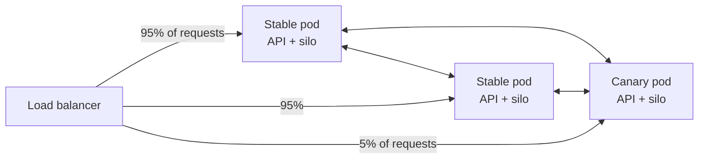

- Placement puts grains on the canary regardless of its 5% of web traffic. It may hold a third of the activations.
- Stable pods call grains on the canary and vice versa, so its grain code serves everybody.
- If it dies, its activations are lost and recreated elsewhere, unsaved state and timers are gone.
- If the canary changes a grain interface or a state class, versioning rules apply. If only endpoint code changed, the grains are unaffected.
- To keep an API canary away from the grains, split the API from the silo. Then the canary pods are clients and host nothing.

A second cluster with the **same** `ServiceId` shares state and reminders with production. The single-activation guarantee is per cluster, so a grain can be active in both. Fine for a short blue/green switch, a bad idea for a canary that runs for days.

---

## Canary vs A/B test (and blue/green)

All three split or switch traffic between two versions. The **goal** differs.

| | Blue/green | Canary | A/B test |
|---|---|---|---|
| Goal | Release with an instant way back | Check that a new version is **safe** | Find out which variant is **better** |
| Question | "Can we switch and undo it quickly?" | "Does it break anything?" | "Which one do users prefer?" |
| Split | One switch, 0% then 100% | Small share first (1-5%), raised step by step | Fixed split (often 50/50) for the test period |
| Measured | Health after the switch | Errors, latency, crashes, resources | Business metrics: clicks, conversions |
| Users | Everyone moves together | Any users, chosen by the load balancer | Same user sees the same variant (sticky) |
| Ends with | Old environment removed | 100% on the new version, or rollback | A winner is picked, the loser removed |
| Decision | Operations | Operations | Product |

- Canary = releasing safely. A/B = learning. The same load balancer feature can do both, which is why they get mixed up.
- In Orleans an A/B test is usually done in the application (a feature flag in the API decides the variant). Both variants run on the same cluster version, no cluster ids involved.
- Canary and blue/green are about versions of the cluster, see the previous slides.

---

## How is load spread? (no work stealing)

A grain's mailbox is private, no other grain takes messages from it. Load is spread differently:

| Need | Mechanism |
|---|---|
| Where a new grain goes | Placement, once at activation |
| Many workers for one hot key | `[StatelessWorker]`, several interchangeable activations per silo (`maxLocalWorkers`), calls go to a free one, no state |
| Move grains afterwards | `AddActivationRebalancer()` (memory/activation balance) and `AddActivationRepartitioner()` (keeps chatty grains together). Both are experimental, need `ORLEANSEXP002` / `ORLEANSEXP001` suppressed |
| Overloaded silo | Load shedding, rejects instead of queueing forever |
| Pull model | Build it: a queue grain workers ask for jobs, or pull-based streams |

Work stealing exists only one level down, in the .NET thread pool.

---

## Rolling updates: versioning

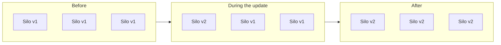

- Old and new silos run side by side, so messages and stored state must understand both versions.
- Serialization: stable `[Id(n)]`, new fields get new ids, never reuse or retype an id, `[Alias]` keeps names stable.
- State in the database: `SchemaVersion` and a migration when the grain activates.
- Grain interfaces: `[Version(2)]` plus a compatibility rule decide which silo may serve which caller.

During a rolling update (fixed ids) there is still **one cluster and one activation per grain**:
- an old pod leaves, its activations are deactivated (state is only what the grains already wrote with `WriteStateAsync`, nothing is saved automatically),
- the next call finds no live activation, placement picks another silo (old or new), the grain reactivates there with its saved state,
- new pods join and take over directory ranges, existing activations stay where they are.

Duplicates only happen around an ungraceful stop, so give pods enough `terminationGracePeriodSeconds`. Two clusters (blue/green) have two directories, there the same id can be active in both.

**What happens to requests that are running?** (from the docs on deactivation)
- A deactivating grain finishes the request it is processing now. Requests still waiting in its mailbox are forwarded to the next activation (the same behaviour as `DeactivateOnIdle`).
- `OnDeactivateAsync` gets a cancellation token: finish promptly. It is not guaranteed to run (crash, kill), so never rely on it to save state.
- Timers die with the activation, reminders live in the database and keep firing.
- If the pod is killed before the grace period ends, running requests are cut and the callers get an error or a timeout. Orleans does not retry for you.
- So: write state when it changes, make calls safe to repeat, set a generous `terminationGracePeriodSeconds`.

---

## Everything in gleis-grain

```mermaid
flowchart TB
    api[Stops API] --> sg[StopGrain linz-hbf]
    sg -- "reminder every minute" --> ing[Ingestion SourceGrain<br/>rate limiter]
    sg -- "timer while watched" --> ing
    ing -- "XML request" --> efa[(Linz AG EFA)]
    ing --> sg
    sg --> state[(stops database)]
    sg -. "membership, reminders" .-> orleans[(orleans database)]
```

Where to show it:
- Dashboard: silos and grains spreading over the cluster.
- pgAdmin: `SELECT * FROM orleansmembershiptable;` and kill a silo.
- Scalar: call an endpoint, watch the trace in the Aspire dashboard.

---

## Questions we asked (1/3): grains and activations

**Does a grain always exist, and who creates the activation?**
Logically yes, any id is valid. Only the in-memory activation comes and goes. The runtime creates it on the first call (placement picks the silo), not the scheduler.

**What is a mailbox?**
The queue of messages waiting for one activation. It handles one message at a time, so no locks.

**What is the directory for, and when is it filled?**
It maps a grain id to the silo that holds the activation. An entry is added when the grain is activated and removed when it is deactivated. It is in memory only.

**What is placement?**
The one-time decision which silo hosts a new activation. It runs only if the grain is not active yet.

**Is the directory distributed? Is it consistent hashing?**
Yes, every silo holds a piece in memory (30 small ranges per silo, not one fixed slice). The hash decides who *knows* where a grain is, not where it runs. Placement decides that.

**What is in a directory entry?**
The grain id, the silo address `ip:port:epoch` and an activation id. The epoch tells a restarted silo apart from its dead predecessor.

**Can one identity have several activations?**
Not for a normal grain: one identity, one activation. Exceptions: `[StatelessWorker]` on purpose, short overlaps during failures and two clusters sharing storage by accident.

**Is there work stealing between grains?**
No. A grain's mailbox is private. Load is spread by placement, `[StatelessWorker]` and (experimental) rebalancing.

---

## Questions we asked (2/3): cluster and deployment

**Which silo belongs to which cluster?**
Configuration decides: the same `ClusterId` and the same membership table. Membership is the agreed list of live silos.

**Is the `ServiceId` a pod name?**
No. It stays the same for all pods and all deployments. `ServiceId` = which application, `ClusterId` = which running copy of it.

**Why two ids, `ServiceId` and `ClusterId`, instead of one?**
Different lifetimes. The `ServiceId` must stay stable because data hangs on it. The `ClusterId` may change per cluster. One id would break either blue/green or the data of a new deployment. Normally both are fixed and equal.

**Can a new cluster still use the old data?**
Yes, with the same `ServiceId` and the same storage: stored state and reminders carry over. Activations, timers, directory entries and membership do not, the new cluster starts cold.

**Do different `ServiceId`s mean several applications in one cluster?**
No. All silos of a cluster share one `ServiceId`. Different applications get their own `ServiceId` and their own cluster, and can share a database.

**Heterogeneous or homogeneous ("mono"): when to switch?**
Homogeneous when contexts call each other a lot, load is small or one team releases everything. Heterogeneous when scaling, ownership or isolation differ.

**Can different deployables share one cluster? Can APIs be clients?**
Yes. API + silo together (this repo), API as client with silos separate, or several client APIs in front of one silo deployable. Clients send messages, the grain updates its own state.

**What is a gateway silo, and is the API in front a bottleneck?**
Clients reach the cluster through gateway silos. The API is stateless and scales out. The real limits are a hot grain, slow calls held open and the database.

**Are environments (dev, test, prod) different clusters?**
Yes, separate clusters. Keep them apart with separate databases. If they share one, use different `ClusterId` and `ServiceId`.

**When are separate clusters a good idea?**
When the parts never call each other's grains: separate applications, tenants, regions, or domains without grain calls between them. Split along the call graph.

**How does blue/green work?**
Start a second cluster with a new `ClusterId` and the same `ServiceId`, test it, switch **all** traffic at once, keep the old one as rollback, then drain it. A gradual shift is a canary. Both share the database for a while, so state must be readable by both versions and the overlap short.

**What is the difference between canary and A/B test?**
Canary checks that a new version is safe (small share first, then more, measured by errors and latency). An A/B test compares two variants for users (fixed split, measured by business metrics, same user sees the same variant).

**What happens to a reminder when its silo is offline?**
Another silo takes over its hash ranges after membership declares it dead, loads the reminders from the table and carries on. Missed ticks are skipped, there is no catch-up and no record of fired ticks.

**What happens to running requests during an update?**
On a graceful stop the current request finishes and queued ones are forwarded to the next activation. If the pod is killed first, they are cut and callers get an error. Timers are lost, reminders and written state survive. State is not saved automatically.

**Is there still one activation per grain during a rolling update?**
Yes. It stays one cluster. A leaving silo's grains reactivate on another silo with their saved state, new silos take over directory ranges.

**Is a canary deployment multi-cluster?**
Usually not. With API and silo in one pod a canary pod is also a silo, so it hosts grains and is a grain canary too. Split API and silo to canary only the API.

---

## Questions we asked (3/3): state and concurrency

**What is an ETag, and does each activation make up its own?**
A version marker created by the storage, changed on every write. The activation only keeps the one it read and sends it back.

**Why optimistic concurrency?**
Conflicts are rare (one activation, one mailbox), so locking every write would cost more than it saves. The ETag catches the rare case, and the loser reloads.

**Is `[ReadOnly]` still one activation?**
Yes. Several `[ReadOnly]` calls may overlap inside it, which only helps when they `await` something.

**Why is the activation bound to the identity?**
One identity means one instance, one mailbox, one copy of the state, one record. Every guarantee depends on it.

**`[Reentrant]` or `[AlwaysInterleave]`?**
`[Reentrant]`: all methods of the class may interleave. `[AlwaysInterleave]`: only the marked method may, the rest stays one at a time. Prefer the second.

**What happens when `Slow` has finished its wait while `Fast` runs?**
`Slow`'s next piece is ready but waits. Nothing is preempted, a piece of code runs until its next `await` or its end.

**So code runs until it finishes or hits its own `await`?**
Yes. Only one piece runs at a time and the switch points are the `await`s.

---

## Take-home

1. A grain is an object you can always call. Orleans decides where it lives.
2. One message at a time, so no locks.
3. Memory is a cache, the database is the truth. Decide what you can afford to lose.
4. Timer for fast and disposable, reminder for durable.
5. Plan for versions from day one.
6. `ServiceId` = which application, `ClusterId` = which running copy of it.

---

## References

- Orleans project site: https://dotnet.github.io/orleans/
- Microsoft Research, Orleans virtual actors (where the idea comes from): https://www.microsoft.com/en-us/research/project/orleans-virtual-actors/
- Microsoft Learn, Orleans docs:
  - Cluster management and the membership protocol: https://learn.microsoft.com/en-us/dotnet/orleans/implementation/cluster-management
  - Grain placement, rebalancing, repartitioning: https://learn.microsoft.com/en-us/dotnet/orleans/grains/grain-placement
  - Stateless worker grains: https://learn.microsoft.com/en-us/dotnet/orleans/grains/stateless-worker-grains
  - Activation collection (idle grains, `DeactivateOnIdle`, `DelayDeactivation`): https://learn.microsoft.com/en-us/dotnet/orleans/host/configuration-guide/activation-collection
  - Grain directory: https://learn.microsoft.com/en-us/dotnet/orleans/host/grain-directory
